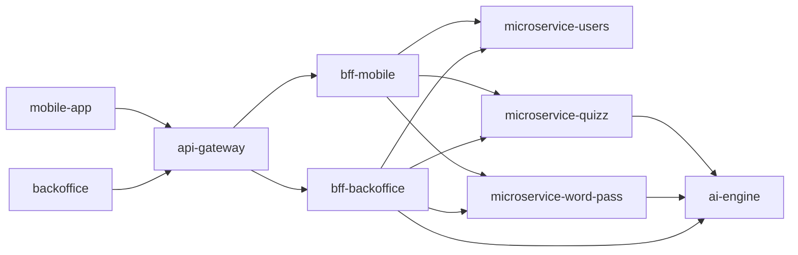

# AxiomNode

**AxiomNode** is an educational AI platform built as a set of microservices, developed as a Master's thesis project. A Kotlin Multiplatform mobile app and a React backoffice talk to an API gateway and Fastify BFFs, which orchestrate domain services backed by PostgreSQL and a Python AI engine (RAG + LLM) that generates quiz and word-pass content. It ships to Kubernetes (k3s) with CI/CD and observability, and every repository carries its own tests, docs and quality gates.

## Architecture

## Repositories

| Repository | What it is |
|---|---|
| [Mobile-App](https://github.com/AxiomNode/Mobile-App) | Kotlin Multiplatform (Compose) client for quiz and word-pass gameplay on Android and iOS |
| [Backoffice](https://github.com/AxiomNode/Backoffice) | React + TypeScript + Vite operations console: health and metrics, AI diagnostics, role-gated admin actions |
| [api-gateway](https://github.com/AxiomNode/api-gateway) | Fastify edge gateway: single public entry point routing to the BFFs and the AI runtime target |
| [bff-mobile](https://github.com/AxiomNode/bff-mobile) | Fastify BFF with mobile-shaped gameplay APIs over the domain microservices |
| [bff-backoffice](https://github.com/AxiomNode/bff-backoffice) | Fastify BFF and runtime control plane for the Backoffice |
| [microservice-users](https://github.com/AxiomNode/microservice-users) | Player identity (Firebase auth), roles, gameplay events, stats and leaderboards |
| [microservice-quizz](https://github.com/AxiomNode/microservice-quizz) | Quiz domain: generation via the AI engine, validation, persistence and history |
| [microservice-word-pass](https://github.com/AxiomNode/microservice-word-pass) | Word-pass domain: generation via the AI engine, validation, persistence and history |
| [ai-engine](https://github.com/AxiomNode/ai-engine) | Python/FastAPI AI engine: RAG ingestion, local/split llama inference, structured game generation |
| [contracts-and-schemas](https://github.com/AxiomNode/contracts-and-schemas) | Versioned OpenAPI specs, JSON Schemas and event contracts |
| [shared-sdk-client](https://github.com/AxiomNode/shared-sdk-client) | Shared SDK workspace: TypeScript client generated from the contracts, plus Python and Kotlin scaffolds |
| [platform-infra](https://github.com/AxiomNode/platform-infra) | Kubernetes (k3s/Kustomize) manifests, environment overlays, image builds and staging rollout |
| [observability-platform](https://github.com/AxiomNode/observability-platform) | Dashboards, alert rules and base stack definitions for metrics, logs and traces |
| [docs](https://github.com/AxiomNode/docs) | Architecture (C4 views, ADRs), capability dossiers, guides and runbooks |

## Tech stack

- **Mobile:** Kotlin Multiplatform, Compose, Firebase authentication
- **Web:** React, TypeScript, Vite
- **Backend:** Fastify, TypeScript, Zod, Prisma, PostgreSQL
- **AI:** Python, FastAPI, RAG, local or split llama-compatible inference, structured generation
- **Delivery:** GitHub Actions, GHCR, Docker, Kubernetes (k3s), Kustomize
- **Observability:** metrics, logs and traces with shared dashboards and alert rules

## Quality bar

- **90 % coverage gates** enforced in CI (Vitest thresholds on the TypeScript services, `fail_under` on the Python engine)
- **CodeQL and Trivy** scans in every service repository
- **Contract-first:** OpenAPI and JSON Schemas live in one repository and the SDK client is generated from them
- **Automated rollout:** a green push to `main` builds images and rolls out staging with smoke checks; production is a controlled manual promotion

## Documentation

Start with [`docs`](https://github.com/AxiomNode/docs). Each repository's own README covers local setup, endpoints and validation commands.

## License

Public repositories are distributed under the MIT License unless a repository states otherwise.
